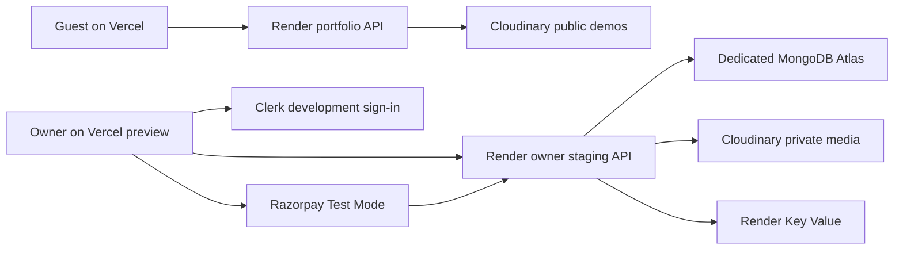

# SocialStudio

SocialStudio is a video studio for turning technical scripts into short explainers. The public portfolio features five finished reels on messaging, load balancing, Bloom filters, Merkle trees, and retrieval-augmented generation.

- [Watch the public demo](https://social-studio-olive.vercel.app/demo)
- [See the Creator plan](https://social-studio-olive.vercel.app/plans)
- [Check the live API](https://socialstudio-backend-kuwv.onrender.com/ready)

## Walkthrough

1. Open **Explore Demo**, choose a reel, and press **Play**. The page loads thumbnails before requesting video.
2. In the private Studio preview, the owner can open saved projects and play their exports through short-lived, signed Cloudinary links.
3. For a project with narration, the Studio builds a ChatGPT prompt from the script and timing data. The owner pastes the resulting visual directives, validates them, and saves the plan. Local workers handle rendering.
4. **Plans & billing** shows generation credit usage and test payment activity. The Creator plan is **500 credits for ₹500**. Staging uses Razorpay Test Mode and an isolated test-credit wallet.

## Architecture



The public deployment serves the portfolio and plans. Staging uses Clerk development authentication, a dedicated Atlas database, private video delivery, and test billing. Public generation, trial credits, and live payments are disabled.

## Run locally

Use Node.js 22 and npm. Install dependencies in the repository root and dashboard.

```sh
npm ci
npm ci --prefix dashboard
npm run api
```

In a second terminal, run `npm run dev:dashboard`. Use `.env.example` and the [staging integration guide](Docs/SAAS_INTEGRATIONS.md) for optional local services and provider configuration. Run `npm run check`, `npm test`, and `npm --prefix dashboard run build` before releasing. See the [implementation and verification record](Docs/IMPLEMENTATION_STATUS.md) for hosted evidence and open checks.
