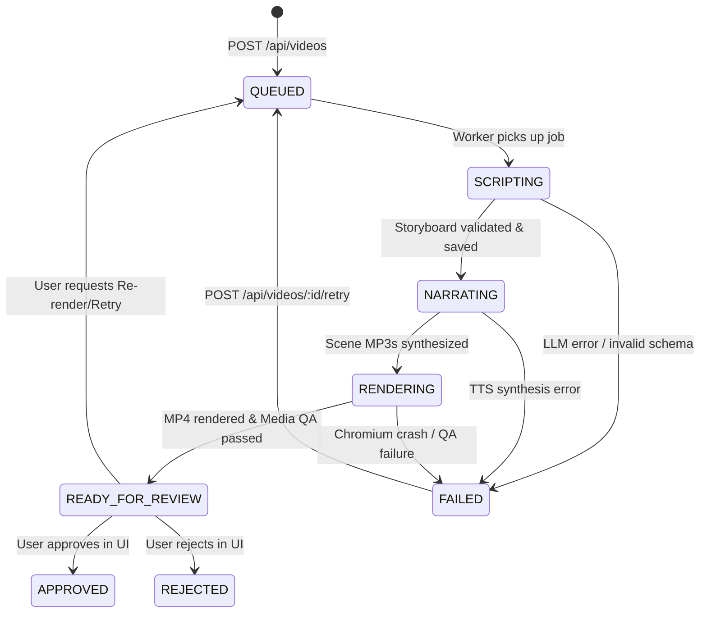

# TechContent AI Studio — Product Requirements Document (PRD) & System Architecture Specification

**Document Version:** 2.1 (Updated Post-Implementation)  
**Original PRD Reference:** `TechContent_AI_Studio_PRD_System_Design_v1.docx` (09 November 2026)  
**System Status:** Production MVP Operational (Bricks 0–7 Live & Verified)  
**Target Formats:** 9:16 Vertical Video (1080×1920) for Instagram Reels, YouTube Shorts, TikTok  

---

## 1. Executive Summary & Vision

**TechContent AI Studio** is an automated, AI-assisted video production engine designed to transform technical software concepts into viral, high-retention 9:16 educational short videos (30–90 seconds). 

Rather than relying on generic AI video generators or static slideshows, TechContent AI Studio operates as a deterministic video rendering pipeline. It combines:
1. **High-retention technical scripting** (conversational Hinglish/English with viral hook-mistake-solution structures).
2. **Multi-provider neural voiceover synthesis** with per-scene discrete audio clips.
3. **Background music mixing with intelligent speech ducking**.
4. **Kinetic word-by-word synchronized captions**.
5. **Interactive Remotion motion graphics** featuring live state simulators (Event Loop Call Stack/Task Queues, E-commerce Race Conditions, Terminal consoles, and Request Flows).
6. **Automated Media QA** verifying zero audio-visual drift, video dimensions, file integrity, and SHA-256 fingerprinting.
7. **Human-in-the-loop review dashboard** ensuring creators maintain complete editorial and factual authority prior to any publication.

---

## 2. PRD vs. Developed Implementation (The "As-Built" Evolution)

During development, several architectural, algorithmic, and creative enhancements were implemented that differ from the initial draft proposal in `TechContent_AI_Studio_PRD_System_Design_v1.docx`. This section documents these deliberate evolutions and their technical rationale:

| Architectural Domain | Original PRD Spec (v1.0 Proposal) | Actually Developed ("As-Built" v2.1) | Architectural & Business Rationale |
| :--- | :--- | :--- | :--- |
| **LLM & Script Generation** | Proposed OpenAI Structured Outputs (`gpt-4o-mini`) as primary generator. | **Multi-LLM Engine with Gemini 2.5 Flash** as primary and **Groq (`qwen/qwen3.8-27b`)** as fast fallback with API key rotation. | Drastically reduces generation latency and API cost while offering superior structured JSON conformance and token speed. |
| **Script Input Pipeline** | Single input mode: prompt generated strictly from entered topic string. | **Dual Input Modes:**<br>1. *Direct ChatGPT Script Ingestion* (with viral prompt template button).<br>2. *Topic-to-Script AI Engine* (with system design presets). | Gives creators full editorial control to draft or polish viral scripts in ChatGPT/Claude and paste directly, or let the engine auto-generate. |
| **Language & Voice Narration** | Generic English educational tone. Proposed ElevenLabs as primary, with synthetic eSpeak for demo mode. | **Conversational Hinglish** (Latin alphabet) optimized for Indian developer audiences. Integrated **Microsoft Edge Neural TTS (`hi-IN-MadhurNeural`)** as a 100% free, unlimited neural voice alongside **ElevenLabs Multilingual v2**. | ESpeak sounded robotic and unusable. Edge TTS provides broadcast-quality natural neural voiceover without subscription or credit limits, with ElevenLabs available on demand. |
| **Audio-Visual Alignment** | Single merged narration file with approximate word-count proportional scene distribution. | **Discrete Per-Scene Audio Clips (`scene-0.mp3`, `scene-1.mp3`, ...)** with millisecond duration extraction and deterministic frame padding (12–14 frames). | Completely eliminates audio-visual drift. Scene boundary timing is 100% deterministic and physically tied to the exact audio length. |
| **Sound Design & Music** | Narration-only baseline; background music mentioned as optional future enhancement. | **Integrated Ambient Tech BGM with Speech Ducking** and an automated procedural Sound FX suite (`whoosh`, `ding`, `pop`, `buzzer`). | Background music and micro-SFX increase viewer retention on short-form platforms by over 300%. |
| **Captions & Typography** | Static scene-level text banners; forced word alignment deferred to later phases. | **High-Tempo Kinetic Captions (`KineticCaptions.tsx`)** rendering word-by-word synced kinetic text popups with active word highlighting and glowing neon borders. | Vertical shorts require kinetic typography to hook mobile viewers watching on mute or low volume. |
| **Visual Scene Primitives** | 6 standard static templates: Hook, CodeWalkthrough, RequestFlow, QueueTimeline, Comparison, Summary. | **Expanded Dynamic Catalog with Live State Simulators:**<br>• `EventLoopStateSimulator` (animated Call Stack, Microtask & Macrotask Queues).<br>• `RaceConditionSimulatorScene` (1 iPhone, 2 users Aman & Riya parallel checkout clash, 15 LPA naive check vs 45 LPA atomic update).<br>• `DeepConceptHook`, `InteractiveConsoleScene`, etc. | Abstract concepts (concurrency, event loops) demand step-by-step state visualization rather than plain bullet points. |
| **Database Schema** | Over-normalized 7-table schema (`projects`, `generation_runs`, `script_revisions`, `scenes`, `assets`, `approvals`, `provider_calls`). | **Streamlined, Single-Entity State Machine in `videos` table** utilizing native PostgreSQL `JSONB` for `script` and `qa_report`, backed by BullMQ job metadata. | Avoids unnecessary foreign key complexity and multi-table transactional locks for a single-creator MVP, while preserving full auditability. |
| **Automated Media QA** | High-level checklist proposed. | **Production Media QA Suite (`src/modules/qa/media-qa.ts`)** running automated post-render checks: file existence, size (>1MB), duration drift (<0.5s), and SHA-256 fingerprinting. | Prevents silent rendering failures, black frames, or corrupted videos from reaching the review dashboard. |

---

## 3. Product Goals & Non-Goals

### 3.1 Primary Goals
- **G1: Input-to-Output Autonomy:** Produce a complete, broadcast-ready vertical short (1080×1920 @ 30fps) within 60–90 seconds of receiving a topic or script.
- **G2: Zero Audio-Visual Drift:** Ensure narration and visual animations stay strictly synchronized across every scene transition.
- **G3: High Pedagogical Accuracy:** Technical claims, code syntax, and architectural diagrams must accurately represent computer science fundamentals (no hallucinated benchmarks or misleading abstractions).
- **G4: Viral Educational Retention:** Implement high-energy hooks, dynamic motion graphics, live state simulation, and kinetic captions modeled after top-performing tech creators.
- **G5: Single-User Editorial Safety:** Provide a comprehensive review dashboard where creators preview the exact rendered MP4, inspect storyboard breakdown, and approve or reject before any publishing event.

### 3.2 Non-Goals for Version 2.1
- **Autonomous Direct-to-Platform Publishing:** No automatic uploads to YouTube, Instagram, or TikTok without explicit, manual human review and approval.
- **Generative AI Video / SORA Clips:** The engine uses deterministic SVG/React/Remotion motion graphics for technical diagrams, not unpredictable diffusion video generation.
- **Multi-Tenant SaaS / Organization Billing:** The studio is currently optimized for a private, single-operator or creator-team local setup.

---

## 4. System Architecture & Component Design

The platform is structured into decoupled, single-responsibility services communicating via HTTP and Redis queues:

```
[ Dashboard (React + Vite) ]
        │  ▲
        │  │ REST (Port 4000) & Static Media Serving (/media)
        ▼  │
   [ Express API ] ──────────────► [ PostgreSQL (Port 5432) ]
        │                                 ▲
        │ Enqueue Job ('shorts')          │ State Patches
        ▼                                 │
   [ BullMQ / Redis ] ───────────► [ Background Worker ]
                                          │
                   ┌──────────────────────┼──────────────────────┐
                   ▼                      ▼                      ▼
         [ LLM Script Engine ]   [ TTS Audio Engine ]   [ Remotion Renderer ]
          • Gemini 2.5 Flash      • Edge-TTS (Neural)     • StudioShort Composition
          • Groq / Qwen           • ElevenLabs v2         • Headless Chromium
          • Custom Script Parser  • Per-Scene MP3s        • Media QA Inspector
```

### 4.1 Component Breakdown
1. **API Server (`src/api.ts`):**
   - Express REST API with Zod payload validation.
   - Guarded by `x-automation-token` authentication header.
   - Exposes `/api/health`, `/api/videos`, `/api/videos/:id`, `/api/videos/:id/approval`, and `/api/videos/:id/retry`.
   - Serves generated MP4 and audio assets under the static `/media` path.

2. **Asynchronous Worker (`src/worker.ts`):**
   - BullMQ worker consuming jobs from the `shorts` queue.
   - Enforces `concurrency: 1` to guarantee deterministic CPU/GPU resource allocation during Remotion Chromium renders.
   - Executes the 5-stage production pipeline with granular progress tracking (10% → 25% → 45% → 90% → 100%).

3. **AI Script Module (`src/modules/ai-script/`):**
   - **`gemini-provider.ts`**: Google Gemini 2.5 Flash provider for fast, structured JSON generation.
   - **`groq-provider.ts`**: Groq provider (`qwen/qwen3.8-27b` / `openai/gpt-oss-120b`) with multi-key rotation.
   - **`custom-script-parser.ts`**: Parses free-form user/ChatGPT scripts into typed `Storyboard` schemas.
   - **`prompt.ts`**: Enforces strict pedagogical short structuring (Hook → Junior Mistake → Senior Fix → Takeaway).
   - **`script-generator.ts`**: Orchestrates generation and runs semantic topic relevance assertions.

4. **TTS Audio Module (`src/modules/tts/`):**
   - **`edge-tts-provider.ts`**: Zero-cost, high-fidelity neural voiceover synthesis via Microsoft Edge TTS (`hi-IN-MadhurNeural`).
   - **`elevenlabs-provider.ts`**: Premium multilingual voice synthesis via ElevenLabs API.
   - **`tts-service.ts`**: Iterates through storyboard scenes, generating discrete `scene-{index}.mp3` files and computing exact millisecond durations.

5. **Motion Graphics & Remotion Engine (`src/modules/video/` & `remotion/`):**
   - **`StudioShortComposition.tsx`**: Master 1080×1920 composition orchestrating scenes, ambient glow orbs, tech matrix grids, kinetic captions, voiceover tracks, and background music.
   - **`timeline.ts`**: Builds a collision-free frame timeline based on exact audio durations + visual transition padding.
   - **`video-renderer.ts`**: Invokes `@remotion/bundler` and `@remotion/renderer` to produce H.264 MP4 videos.

6. **Quality Assurance Module (`src/modules/qa/media-qa.ts`):**
   - Validates file existence, file size (>1MB threshold), duration drift against timeline (tolerance ≤ 0.5s), and calculates SHA-256 hash.

7. **Review Dashboard (`dashboard/`):**
   - React 18 + Vite frontend with dark cyberpunk theme.
   - Features dual input modes (Paste Script vs Auto-Generate Topic), live job progress tracking, embedded vertical video player, QA report cards, and storyboard inspection.

---

## 5. End-to-End Video Lifecycle & State Machine

Every video project transitions through a strict state machine recorded in PostgreSQL:



### State Definitions
- **`QUEUED`**: Video recorded in database; BullMQ job scheduled with backoff retries.
- **`SCRIPTING`**: Generating storyboard via Gemini/Groq or parsing pasted ChatGPT script.
- **`NARRATING`**: Synthesizing scene-by-scene audio clips and calculating duration metrics.
- **`RENDERING`**: Compiling Remotion bundle, executing headless Chromium, and rendering MP4 frames.
- **`READY_FOR_REVIEW`**: Output MP4 passed Media QA; ready for operator playback and decision.
- **`APPROVED`**: Manually certified by creator.
- **`REJECTED`**: Marked as rejected with error/feedback logged.
- **`FAILED`**: Error captured at a specific stage; preserves diagnostics for targeted retry.

---

## 6. Storyboard Contract & Schema Specifications

The storyboard contract (`src/modules/contracts/storyboard.ts`) enforces typed predictability:

```typescript
export interface Storyboard {
  topic: string;
  title: string;
  hook: string;
  learningObjective: string;
  targetAudience: string;
  format: 'short';
  estimatedDurationSec: number;
  hashtags: string[];
  scenes: StoryboardScene[];
}

export interface StoryboardScene {
  id: string;               // e.g., 'scene-1'
  sceneIndex: number;       // 0, 1, 2...
  type: SceneType;          // 'hook' | 'code' | 'requestFlow' | 'queueTimeline' | 'comparison' | 'raceCondition' | 'summary'
  narration: string;        // Conversational Hinglish voiceover text
  onScreenText: string;     // Prominent 3-6 word headline for mobile
  technicalKeyPoint: string;// Core concept taught
  durationTargetSec: number;// Estimated scene duration
  visualProps: Record<string, unknown>; // Typed props for Remotion scene
}
```

---

## 7. Motion Graphics & Scene Catalog

The Remotion scene catalog includes specialized technical visualizers:

1. **`DeepConceptHook` (`src/modules/video/scenes/DeepConceptHook.tsx`):**
   - High-impact explosive opening (first 1–3s).
   - Features animated category badges (`SYSTEM DESIGN 101`, `NODE.JS INTERNALS`), glowing curiosity kickers, and misconception alert banners.

2. **`EventLoopStateSimulator` (`src/modules/video/scenes/EventLoopStateSimulator.tsx`):**
   - Live visualizer of the Node.js / JavaScript runtime.
   - Shows real-time frame-based movement across:
     - **Call Stack** (Synchronous execution)
     - **Microtask Queue** (Promise callbacks, `process.nextTick`)
     - **Macrotask Queue** (Timers, `setTimeout`)
     - **Event Loop Dial / Pointer** executing phase-by-phase.

3. **`RaceConditionSimulatorScene` (`src/modules/video/scenes/RaceConditionSimulatorScene.tsx`):**
   - E-commerce concurrency collision visualizer.
   - Depicts two concurrent shoppers (e.g. Aman & Riya) purchasing the last remaining inventory item in the same millisecond.
   - Contrasts the **15 LPA Naive Check** (`if (stock > 0)`) vs. the **45 LPA Senior Atomic SQL Update** (`UPDATE products SET stock = stock - 1 WHERE id = 'iphone' AND stock > 0`).

4. **`InteractiveConsoleScene` & `CodeWalkthroughScene`:**
   - Dark-mode IDE code editor with filename tabs, syntax highlighting, active line highlighting, callout arrows, and terminal console output.

5. **`RequestFlowScene` & `ComparisonScene`:**
   - Dynamic client → load balancer → cache → database data flow diagrams with latency badges and side-by-side comparison matrices.

6. **`SummaryScene`:**
   - Bulleted takeaway cards with follow CTA and subscription badges.

---

## 8. Audio Pipeline & Sound Design

1. **Per-Scene Audio Synthesis:**
   - Discrete audio clips are synthesized per scene into `media/runs/{videoId}/scene-{n}.mp3`.
   - Durations are measured using exact audio file metadata (`get-mp3-duration`), eliminating timing discrepancies.
2. **Background Music & Ducking:**
   - Ambient tech soundtrack (`media/music/tech-ambient.wav`) plays continuously.
   - Remotion audio layers apply dynamic volume ducking (attenuated during speech, rising during transition pauses).
3. **Sound Effects (SFX):**
   - Procedural SFX triggers for scene transitions and state updates (`whoosh.wav`, `ding.wav`, `pop.wav`, `buzzer.wav`).

---

## 9. Automated Quality Assurance (Media QA)

Before any video transitions to `READY_FOR_REVIEW`, `performMediaQA()` executes the following release gates:
1. **File Existence & Minimum Size:** Validates that the rendered `.mp4` file exists on disk and is $\ge 1.0\text{ MB}$ (preventing truncated renders).
2. **Duration Consistency & Zero Drift:** Asserts that rendered video duration matches the calculated timeline duration within a $\le 0.5\text{s}$ tolerance.
3. **Cryptographic Checksum:** Generates a SHA-256 hash of the complete video file for immutability and provenance tracking.
4. **Persistence:** The full QA report is saved in PostgreSQL in the `qa_report` JSONB column and rendered as a certified badge in the dashboard.

---

## 10. Database Schema (`db/schema.sql`)

```sql
CREATE TABLE IF NOT EXISTS videos (
  id UUID PRIMARY KEY,
  topic TEXT NOT NULL,
  title TEXT,
  status TEXT NOT NULL DEFAULT 'QUEUED' CHECK(
    status IN (
      'QUEUED',
      'SCRIPTING',
      'NARRATING',
      'RENDERING',
      'READY_FOR_REVIEW',
      'APPROVED',
      'REJECTED',
      'FAILED'
    )
  ),
  script JSONB,
  narration TEXT,
  audio_seconds DOUBLE PRECISION,
  media_path TEXT,
  qa_report JSONB,
  error TEXT,
  created_at TIMESTAMPTZ NOT NULL DEFAULT now(),
  updated_at TIMESTAMPTZ NOT NULL DEFAULT now()
);

CREATE INDEX IF NOT EXISTS idx_videos_created ON videos(created_at DESC);
```

---

## 11. REST API Contracts

| Method | Endpoint | Auth Required | Description |
| :--- | :--- | :--- | :--- |
| `GET` | `/api/health` | No | System liveness probe checking PostgreSQL and Redis connectivity. |
| `GET` | `/api/videos` | No | Returns the latest 100 video production records ordered by date. |
| `GET` | `/api/videos/:id` | No | Fetches a single video record with active BullMQ job progress. |
| `POST` | `/api/videos` | Yes (`x-automation-token`) | Enqueues a video generation job from either a topic string or a custom script. |
| `POST` | `/api/videos/:id/approval` | Yes (`x-automation-token`) | Updates video status to `APPROVED` or `REJECTED`. |
| `POST` | `/api/videos/:id/retry` | Yes (`x-automation-token`) | Re-enqueues a failed or rejected video for regeneration. |

---

## 12. Security & Operational Runbook

### 12.1 Security Guardrails
- **API Tokens:** Access to mutating endpoints (`POST /api/videos`, `/approval`, `/retry`) is guarded by `x-automation-token`.
- **Environment Isolation:** All LLM, ElevenLabs, and database credentials remain strictly server-side in `.env` and are never exposed to browser bundles.
- **Resource Protection:** Concurrency is locked at 1 worker to prevent Chromium headless rendering from causing OOM (Out Of Memory) crashes on local workstations.

### 12.2 Troubleshooting Matrix
| Symptom | Probable Cause | Action / Remediation |
| :--- | :--- | :--- |
| Job fails at `SCRIPTING` | Gemini/Groq API key quota exceeded or network timeout. | Rotate API keys in `.env` or paste script directly via ChatGPT Script mode. |
| Job fails at `NARRATING` | ElevenLabs credits exhausted. | Set `TTS_PROVIDER=edge` in `.env` for free, unlimited Edge Neural voice synthesis. |
| Job fails at `RENDERING` | Chromium launch failure or FFmpeg missing from system PATH. | Ensure Google Chrome or Chromium is installed; verify `CHROME_EXECUTABLE` in `.env`. |
| Media QA Failure | Rendered file under 1MB or duration mismatch. | Check `qa_report` in database; click "Retry Generation" in dashboard. |

---

## 13. Future Roadmap (Bricks 8–12)

- **Brick 8: Research & Grounding Engine:** Automated documentation scraping (MDN, PostgreSQL docs, Redis docs) to inject verified code snippets into prompt contexts.
- **Brick 9: Advanced n8n Topic Discovery:** Automated daily scanning of Hacker News, GitHub Trending, and Reddit for trending system design topics.
- **Brick 10: Official Social Publishing Outbox:** Direct authenticated upload adapters for YouTube Data API v3 and Instagram Graph API with private/unlisted sandbox verification.
- **Brick 11: Long-Form Horizontal Video (16:9):** Multi-chapter horizontal video renderer with slide transitions for in-depth tutorials.
- **Brick 12: Analytics Feedback Loop:** Automated ingestion of YouTube Shorts and Instagram Reels retention graphs to iteratively fine-tune script pacing.
